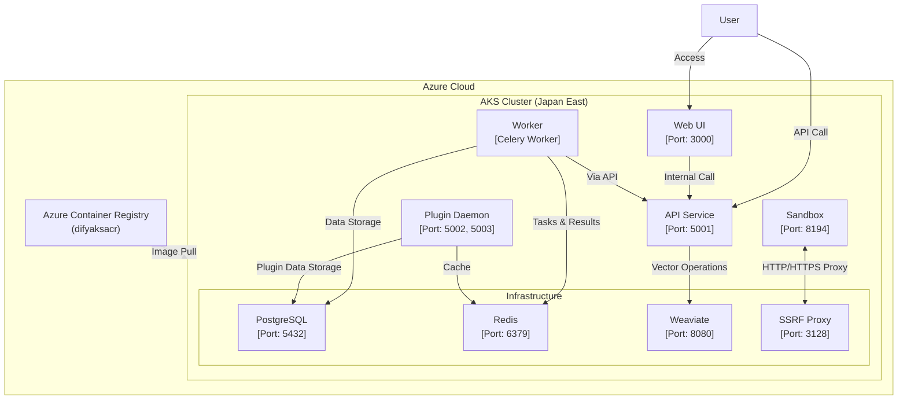
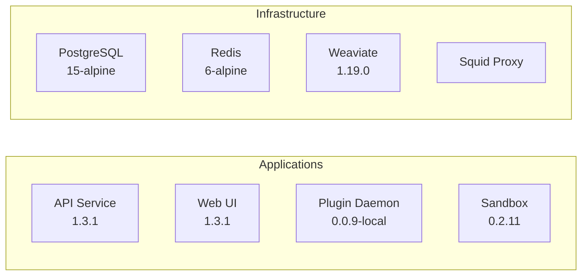
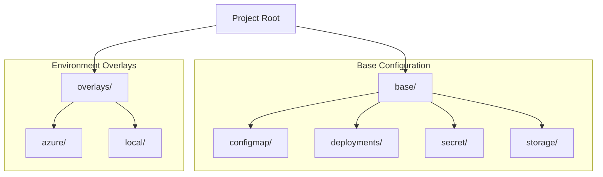
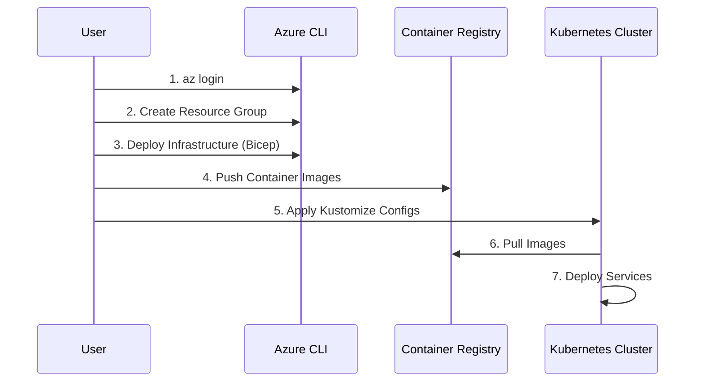
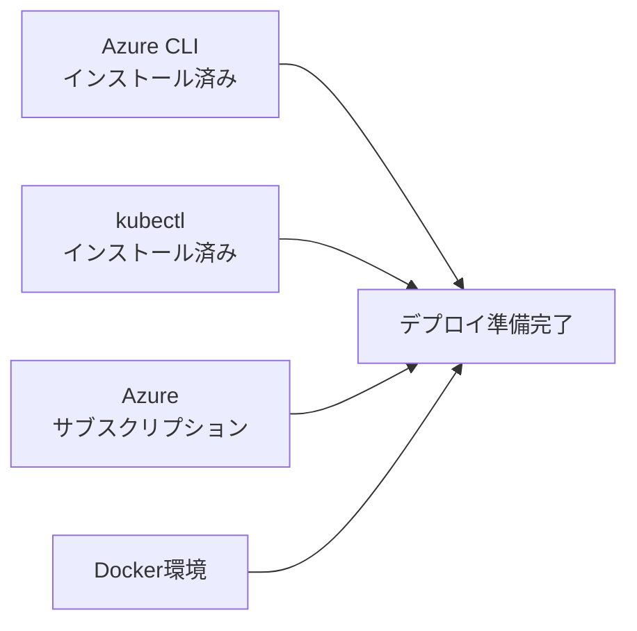
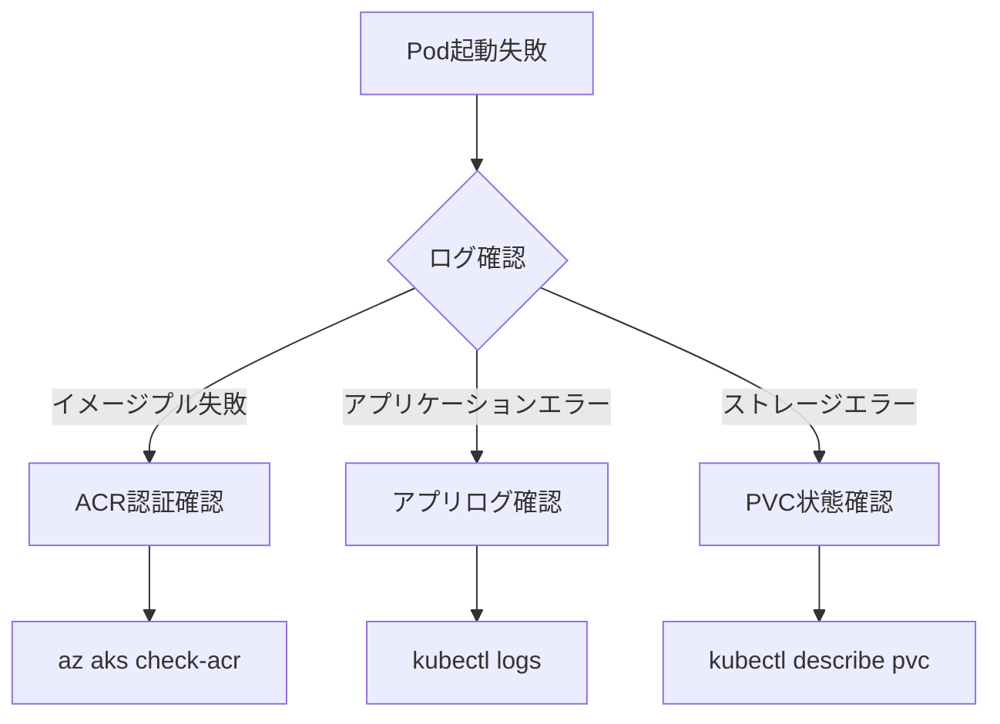
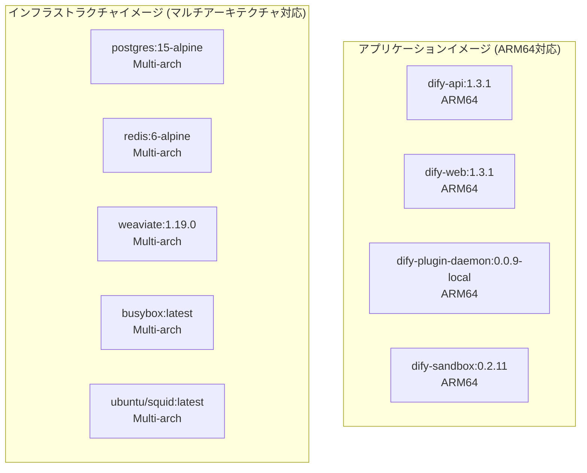

# Dify on AKS プロジェクト説明資料

## 1. システム概要


## 2. 環境構成

### 2.1 インフラストラクチャ仕様
- **AKSクラスター**
  - リージョン: Japan East
  - ノードサイズ: Standard_D8ps_v5
  - ノード数: 1
  - Kubernetesバージョン: 1.32.4

### 2.2 主要コンポーネント


## 3. ディレクトリ構造


### 詳細なディレクトリ構造
```
.
├── main.bicep                         # AKSインフラストラクチャ定義
├── parameters.json                    # Bicepパラメータ
├── base/                             # ベース設定
│   ├── kustomization.yaml            # ベース設定のKustomize定義
│   ├── namespace.yaml                # 名前空間定義
│   ├── configmap/                    # ConfigMap定義
│   │   ├── postgres-config.yaml      # PostgreSQL設定
│   │   ├── postgres-init.yaml        # PostgreSQL初期化スクリプト
│   │   ├── sandbox-config.yaml       # Sandbox設定
│   │   └── shared-config.yaml        # 共有設定
│   ├── deployments/                  # デプロイメント定義
│   │   ├── api.yaml                  # APIサービス
│   │   ├── db.yaml                   # PostgreSQL
│   │   ├── plugin-daemon.yaml        # プラグインデーモン
│   │   ├── redis.yaml               # Redisキャッシュ
│   │   ├── sandbox.yaml             # サンドボックス
│   │   ├── ssrf-proxy.yaml          # SSRFプロキシ
│   │   ├── weaviate.yaml            # ベクトルDB
│   │   ├── web.yaml                 # WebUI
│   │   └── worker.yaml              # Celeryワーカー
│   ├── secret/                      # シークレット定義
│   │   ├── db-secret.yaml           # DB認証情報
│   │   ├── mail-secret.yaml         # メール設定
│   │   ├── model-provider-secret.yaml # AIモデル設定
│   │   ├── plugin-daemon-secret.yaml  # プラグイン認証情報
│   │   └── redis-secret.yaml         # Redis認証情報
│   └── storage/                      # ストレージ設定
│       └── persistent-volume-claims.yaml # 永続ボリューム要求
└── overlays/                         # 環境固有の設定
    ├── azure/                        # Azure環境設定
    │   ├── api-init-patch.yaml       # API初期化パッチ
    │   ├── api-service-patch.yaml    # APIサービスパッチ
    │   ├── configmap-patch.yaml      # ConfigMapパッチ
    │   ├── configmap-updater-rbac.yaml # RBAC設定
    │   ├── image-patch.yaml          # イメージパッチ
    │   ├── init-configmap-job.yaml   # 初期化ジョブ
    │   ├── kustomization.yaml        # Azure用Kustomize
    │   ├── storage-patch.yaml        # ストレージパッチ
    │   └── web-service-patch.yaml    # WebUIパッチ
    └── local/                        # ローカル環境設定
        └── kustomization.yaml        # ローカル用Kustomize
```

## 4. デプロイメントフロー


## 5. Kustomize構成管理

### 5.1 Kustomizeとは
Kustomizeは、Kubernetesのネイティブな設定管理ツールです。以下の特徴があります：

- **設定の階層化**：
  - ベース設定（base）：全環境で共通の基本設定
  - オーバーレイ（overlays）：環境固有のカスタマイズ

- **パッチによるカスタマイズ**：
  - 既存のマニフェストを変更せずに設定を上書き
  - 環境ごとの違いを最小限の記述で管理

- **主な機能**：
  - CommonLabelsの一括設定
  - イメージタグの変更
  - ConfigMapとSecretの生成
  - リソース間の依存関係管理

- **使用方法**：
  - `kubectl apply -k <ディレクトリ>` でデプロイ
  - `kustomization.yaml` で設定をまとめて管理

### 5.2 プロジェクトのKustomize構成

- **ベース設定（`base/`）**
  - 共通のKubernetesマニフェスト
  - ConfigMap、Secret定義
  - 基本的なデプロイメント設定

- **Azure環境オーバーレイ（`overlays/azure/`）**
  - LoadBalancerサービス設定
  - ストレージクラス設定
  - イメージレジストリパッチ
  - 初期化ジョブ設定

- **ローカル環境オーバーレイ（`overlays/local/`）**
  - 開発環境用の設定

## 6. デプロイ手順書

### 6.1 前提条件


### 6.2 デプロイステップ
1. **環境準備**
   ```bash
   # Azureログイン
   az login

   # リソースグループ作成
   az group create --name dify-rg --location japaneast
   ```

2. **インフラストラクチャのデプロイ**
   ```bash
   # Bicepテンプレートを使用したデプロイ
   az deployment group create \
     --name dify-deployment \
     --resource-group dify-rg \
     --template-file main.bicep \
     --parameters parameters.json

   # AKS認証情報の取得
   az aks get-credentials --resource-group dify-rg --name dify-aks
   ```

3. **コンテナイメージの準備**
   ```mermaid
   flowchart TD
    A[ACRログイン] -->|az acr login| B[イメージタグ付け]
    B --> C[イメージプッシュ]
    C --> D[デプロイ準備完了]
   ```

   ```bash
   # ACRログイン
   az acr login --name difyaksacr
   
   # イメージのタグ付けとプッシュ
   for img in \
     "langgenius/dify-api:1.3.1" \
     "langgenius/dify-web:1.3.1" \
     "langgenius/dify-plugin-daemon:0.0.9-local" \
     "langgenius/dify-sandbox:0.2.11" \
     "postgres:15-alpine" \
     "redis:6-alpine" \
     "semitechnologies/weaviate:1.19.0" \
     "busybox:latest" \
     "ubuntu/squid:latest"
   do
     name=$(echo $img | cut -d/ -f2)
     docker tag $img difyaksacr.azurecr.io/$name
     docker push difyaksacr.azurecr.io/$name
   done
   ```

4. **アプリケーションのデプロイ**
   ```mermaid
   sequenceDiagram
       participant U as User
       participant K as Kubernetes
       participant P as Pods
       
       U->>K: kubectl apply -k overlays/azure
       K->>P: Create Namespaces
       K->>P: Deploy ConfigMaps
       K->>P: Deploy Secrets
       K->>P: Deploy Storage
       K->>P: Deploy Applications
       U->>K: kubectl get pods -n dify
       K-->>U: Show Pod Status
       U->>K: kubectl get services -n dify
       K-->>U: Show Service IPs
   ```

5. **デプロイ検証**
   ```bash
   # Podの状態確認
   kubectl get pods -n dify -w

   # サービスの外部IP確認
   kubectl get services -n dify
   ```

### 6.3 アクセス情報
- Web UI: `http://<web-svc-external-ip>`
- API: `http://<api-svc-external-ip>:5001`

### 6.4 トラブルシューティング


### 6.5 クリーンアップ手順
```bash
# Kubernetesリソースの削除
kubectl delete -k overlays/azure

# Azureリソースの削除
az group delete --name dify-rg --yes
```

## 7. イメージアーキテクチャ情報

### 7.1 実行環境
- AKSノードタイプ: Standard_D8ps_v5 (ARM64  ❌x86_64)
- リージョン: Japan East

### 7.2 コンテナイメージ一覧


### 7.3 イメージ詳細
| コンポーネント | イメージ名 | バージョン | アーキテクチャ対応 |
|--------------|-----------|------------|----------------|
| API Service | dify-api | 1.3.1 | ARM64 |
| Web UI | dify-web | 1.3.1 | ARM64 |
| Plugin Daemon | dify-plugin-daemon | 0.0.9-local | ARM64 |
| Sandbox | dify-sandbox | 0.2.11 | ARM64 |
| Database | postgres | 15-alpine | Multi-arch |
| Cache | redis | 6-alpine | Multi-arch |
| Vector DB | weaviate | 1.19.0 | Multi-arch |
| Init Container | busybox | latest | Multi-arch |
| SSRF Proxy | ubuntu/squid | latest | Multi-arch |

### 7.4 アーキテクチャ互換性に関する注意事項
- すべてのアプリケーションイメージは ARM64 アーキテクチャ向けに最適化されています
- インフラストラクチャコンポーネントは公式のマルチアーキテクチャイメージを使用し、ARM64プラットフォームに自動的に対応します
- AKSクラスターはARM64ベースのノード（Standard_D8ps_v5）を使用しているため、すべてのイメージがこのアーキテクチャで実行可能です
